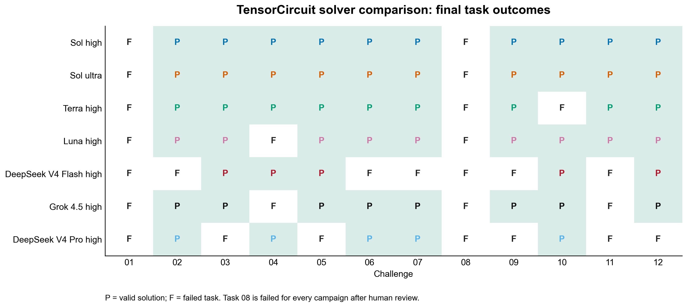
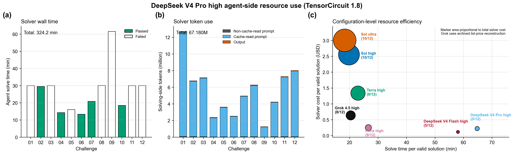

# DeepSeek V4 Pro (high) on ORBIT-Q — TensorCircuit 1.8 rerun

DeepSeek V4 Pro solved **5/12** challenges. The valid solutions are Tasks **02, 04, 06, 07, and 10**. GPT-5.6 Sol (high) independently audited every candidate.

## Results

| Task | Outcome | Candidate runtime | Reason when failed |
|---:|:---:|---:|---|
| 01 | F | — | Agent reached the 1800 s limit. |
| 02 | P | 21.66 s | — |
| 03 | F | — | Agent reached the 1800 s limit. |
| 04 | P | 20.23 s | — |
| 05 | F | 77.39 s | Functional checks passed, but the audit rejected problem fidelity / implementation correctness. |
| 06 | P | 36.23 s | — |
| 07 | P | 97.41 s | — |
| 08 | F | 18.99 s | Agent timeout; also negative under the campaign-wide human Task 08 adjudication. |
| 09 | F | 98.91 s | Functional checks passed, but the audit found evaluator exploitation rather than the full requested optimization. |
| 10 | P | 54.27 s | — |
| 11 | F | — | Agent reached the 1800 s limit. |
| 12 | F | — | Agent reached the 1800 s limit. |

The campaign produced 7 functional passes and 5 final audit-approved passes.

## Agent-side resources

- Agent wall time: **324.22 min** total.
- Solving-side tokens: **67.180M** total: 66.516M prompt tokens and 0.664M output tokens.
- Recorded solver cost: **$1.101116** total, or **$0.220223 per valid solution**.

## Protocol and provenance

- Solver: `deepseek-v4-pro`, reasoning effort `high`.
- Auditor: `gpt-5.6-sol`, reasoning effort `high`.
- TensorCircuit: exactly `1.8.0.dev20260726`.
- Immutable Docker image ID: `sha256:b059c5fa7f75702f9afbf94ec7866e102ac32afd59d25634ec0aca0fd56e2833`.
- Resources per task: 6 CPU, 10,240 MiB memory, 16,384 MiB storage.
- Execution: sequential; one valid non-infrastructure outcome per task; all selected attempts are `r1`.
- Frozen benchmark base: `0201238ec2983907e2891f5319f5fff2d00844d5`.
- Aggregate task-copy SHA-256: `19fe27b83eaf668b3df32d1a68902b08cbe28585f189290769018eb16d927895`.

The earlier TensorCircuit 1.7 Pro campaign is excluded and none of its outcomes are selected here. Each `challenge-XX/` folder contains the available solution, verifier records, logs, configuration, and provenance stamp. Machine-readable aggregates are in [`summary.json`](summary.json).
