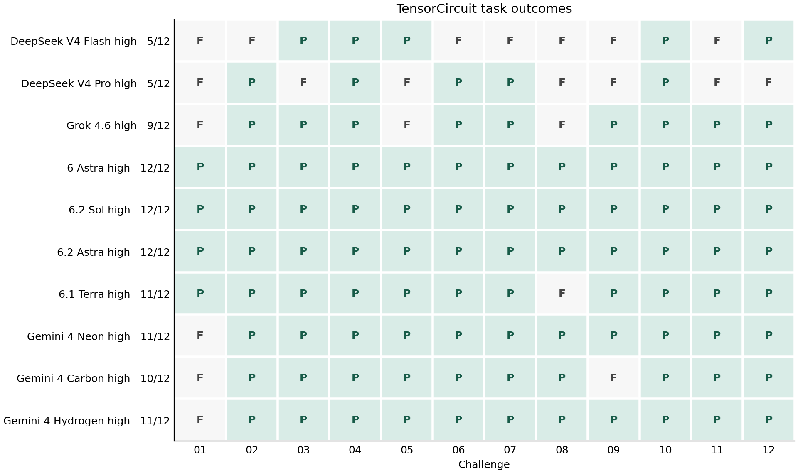
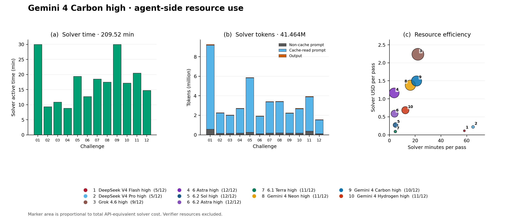
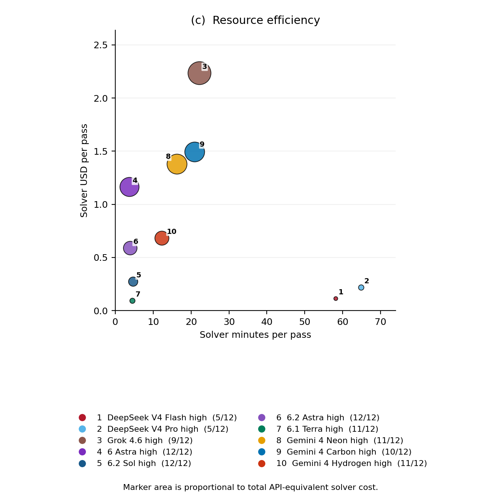
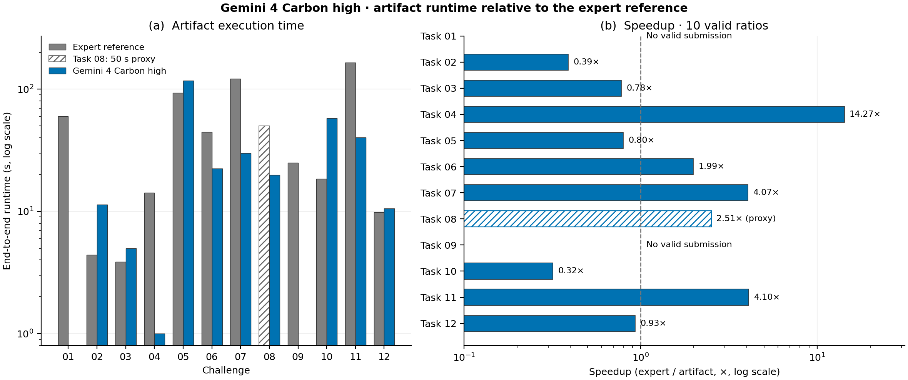
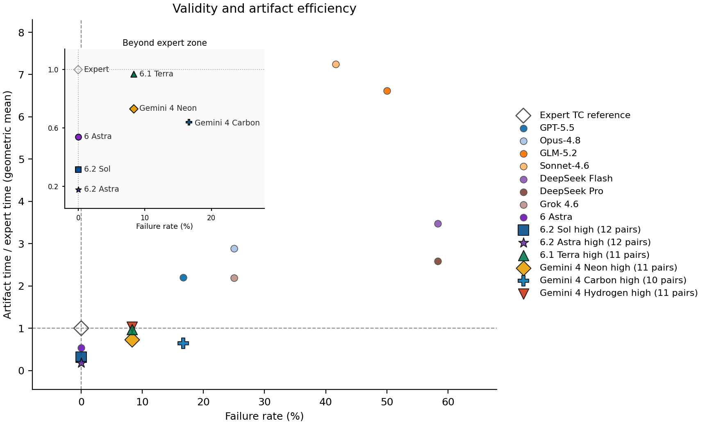

# Gemini 4 Carbon high benchmark results

**10/12 automatic passes** on TensorCircuit 1.8 in **Antigravity** (`antigravity-cli 1.5.17`), audited by Gemini 4 Neon high in Antigravity. Selected solver executions: **209.52 awake minutes**, **$14.9595** API-equivalent recorded. Geometric mean artifact/expert runtime: **0.641×** (9 measured pairs and one estimated expert reference; lower is faster).

The reported cohort is the complete 12-task round executed in Antigravity (`antigravity-cli 1.5.17`, `gemini-4-carbon-high`, `high` effort) and uniformly audited in Antigravity by `gemini-4-neon-high` (`high` effort). Tasks 01, 09 timed out at the 1,800 s agent limit without submitting a solution.

| Challenge | Functional | Static | Audit | Expert (s) | Artifact (s) | Artifact / expert |
|---|---:|---:|---:|---:|---:|---:|
| 01 | 0 | 0 | 0 | 59.83 | — | — |
| 02 | 1 | 1 | 1 | 4.41 | 11.34 | 2.57× |
| 03 | 1 | 1 | 1 | 3.88 | 4.98 | 1.28× |
| 04 | 1 | 1 | 1 | 14.27 | 1.00 | 0.07× |
| 05 | 1 | 1 | 1 | 93.60 | 117.32 | 1.25× |
| 06 | 1 | 1 | 1 | 44.67 | 22.42 | 0.50× |
| 07 | 1 | 1 | 1 | 121.71 | 29.93 | 0.25× |
| 08 | 1 | 1 | 1 | 50.00 (est.) | 19.89 | 0.40× |
| 09 | 0 | 0 | 0 | 25.10 | — | — |
| 10 | 1 | 1 | 1 | 18.40 | 57.79 | 3.14× |
| 11 | 1 | 1 | 1 | 165.32 | 40.29 | 0.24× |
| 12 | 1 | 1 | 1 | 9.83 | 10.56 | 1.07× |

Direct same-host measurement unavailable: 01 (no valid submission); 08 (expert exceeded the memory limit); 09 (no valid submission). [Replay evidence](timing-evidence.json).

Task 08 uses the [reviewer’s expert-reference replacement](https://github.com/sxzgroup/ORBIT-Q/pull/29#issuecomment-5549266776): 25.05 s × 2, rounded to **50 s**. Only the expert reference is estimated. The measured-only geometric mean is 0.676× (9 pairs).

[Methods](METHODS.md) · [Trial records](trials.json) · [Published runtimes](published-runtimes.json) · [Measured pairs](paired-runtimes.json)

