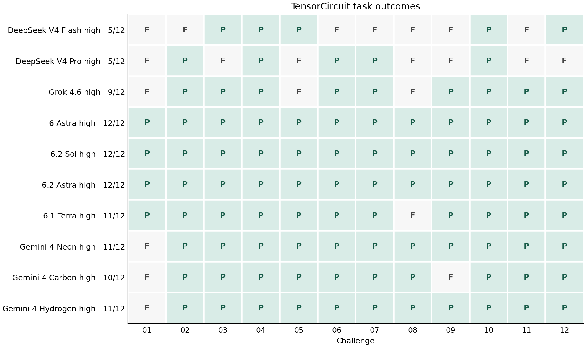
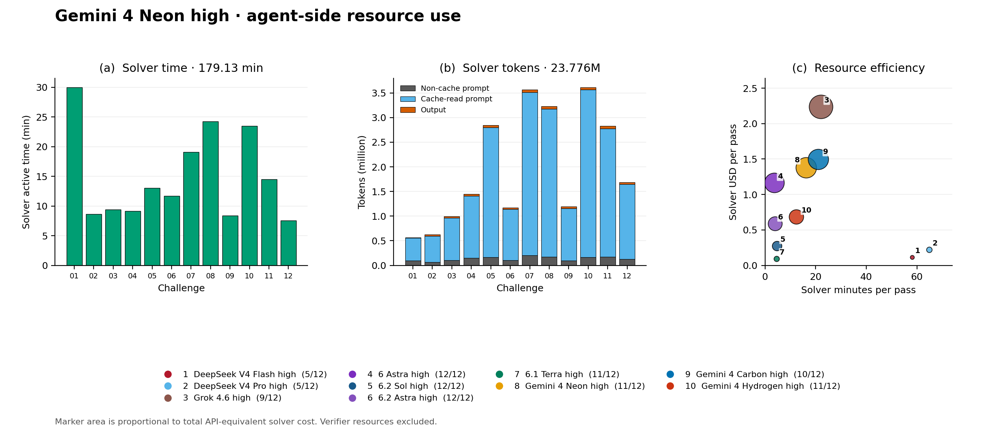
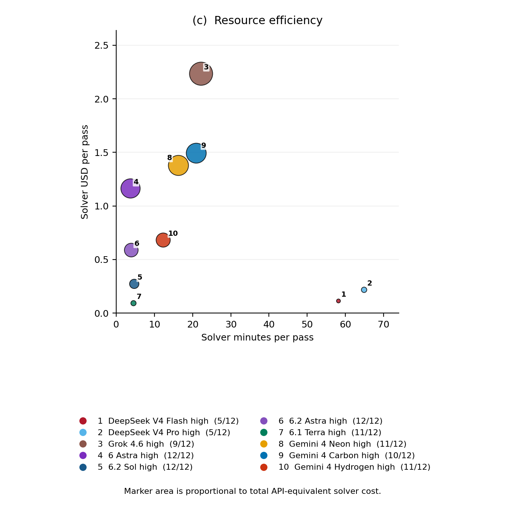
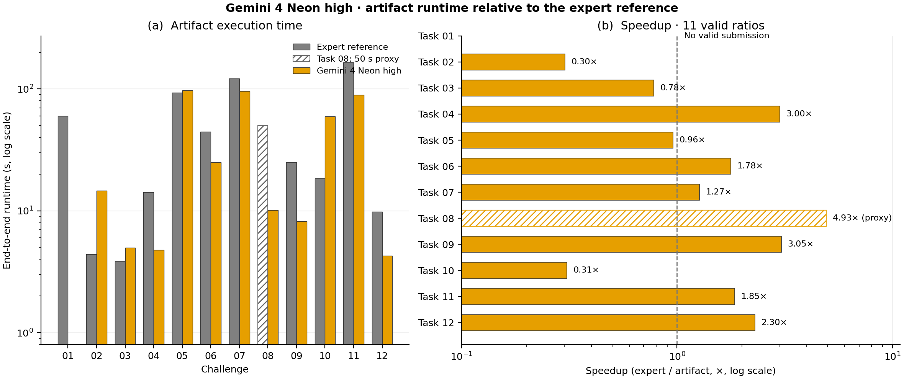
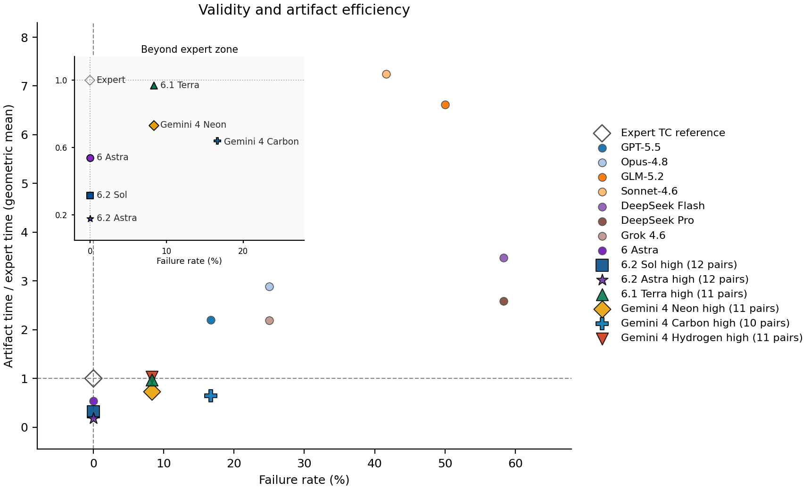

# Gemini 4 Neon high benchmark results

**11/12 automatic passes** on TensorCircuit 1.8 in **Antigravity** (`antigravity-cli 1.5.17`), audited by Gemini 4 Neon high in Antigravity. Selected solver executions: **179.13 awake minutes**, **$15.1832** API-equivalent recorded. Geometric mean artifact/expert runtime: **0.733×** (10 measured pairs and one estimated expert reference; lower is faster).

The reported cohort is the complete 12-task round executed in Antigravity (`antigravity-cli 1.5.17`, `gemini-4-neon-high`, `high` effort) and uniformly audited in Antigravity by `gemini-4-neon-high` (`high` effort). Task 01 timed out at the 1,800 s agent limit without submitting a solution.

| Challenge | Functional | Static | Audit | Expert (s) | Artifact (s) | Artifact / expert |
|---|---:|---:|---:|---:|---:|---:|
| 01 | 0 | 0 | 0 | 59.83 | — | — |
| 02 | 1 | 1 | 1 | 4.41 | 14.60 | 3.31× |
| 03 | 1 | 1 | 1 | 3.88 | 4.98 | 1.28× |
| 04 | 1 | 1 | 1 | 14.27 | 4.76 | 0.33× |
| 05 | 1 | 1 | 1 | 93.60 | 97.61 | 1.04× |
| 06 | 1 | 1 | 1 | 44.67 | 25.10 | 0.56× |
| 07 | 1 | 1 | 1 | 121.71 | 95.77 | 0.79× |
| 08 | 1 | 1 | 1 | 50.00 (est.) | 10.14 | 0.20× |
| 09 | 1 | 1 | 1 | 25.10 | 8.22 | 0.33× |
| 10 | 1 | 1 | 1 | 18.40 | 59.69 | 3.24× |
| 11 | 1 | 1 | 1 | 165.32 | 89.15 | 0.54× |
| 12 | 1 | 1 | 1 | 9.83 | 4.28 | 0.44× |

Direct same-host measurement unavailable: 01 (no valid submission); 08 (expert exceeded the memory limit). [Replay evidence](../gemini-4-neon-high-benchmark/timing-evidence.json).

Task 08 uses the [reviewer’s expert-reference replacement](https://github.com/sxzgroup/ORBIT-Q/pull/29#issuecomment-5549266776): 25.05 s × 2, rounded to **50 s**. Only the expert reference is estimated. The measured-only geometric mean is 0.834× (10 pairs).

[Methods](../gemini-4-neon-high-benchmark/METHODS.md) · [Trial records](../gemini-4-neon-high-benchmark/trials.json) · [Published runtimes](../gemini-4-neon-high-benchmark/published-runtimes.json) · [Measured pairs](../gemini-4-neon-high-benchmark/paired-runtimes.json)

