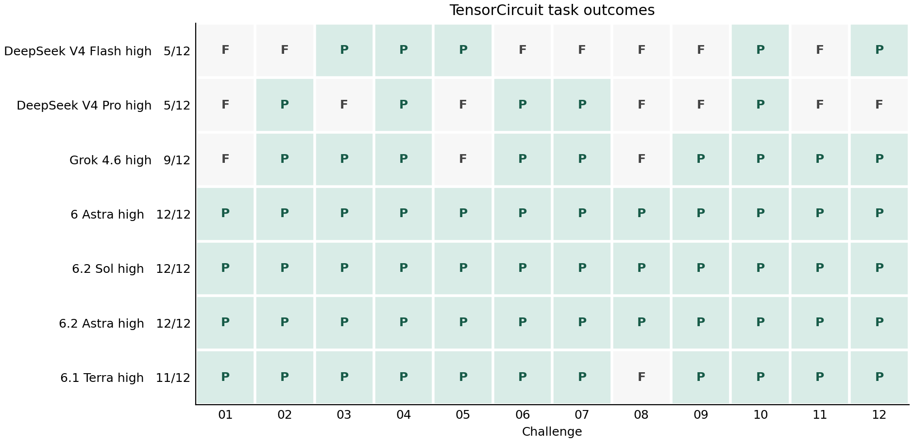
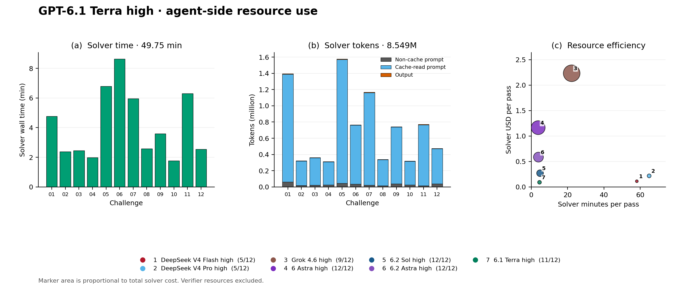
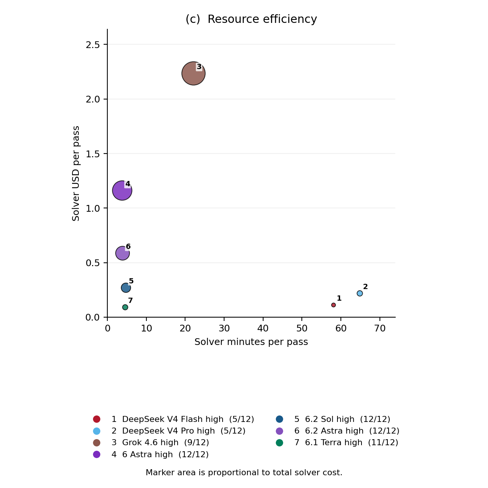
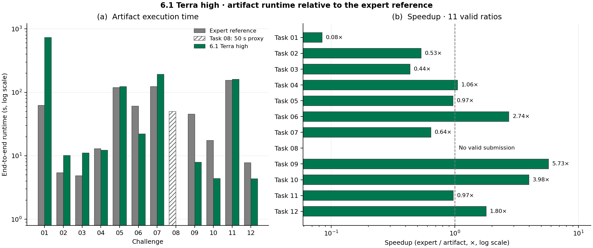
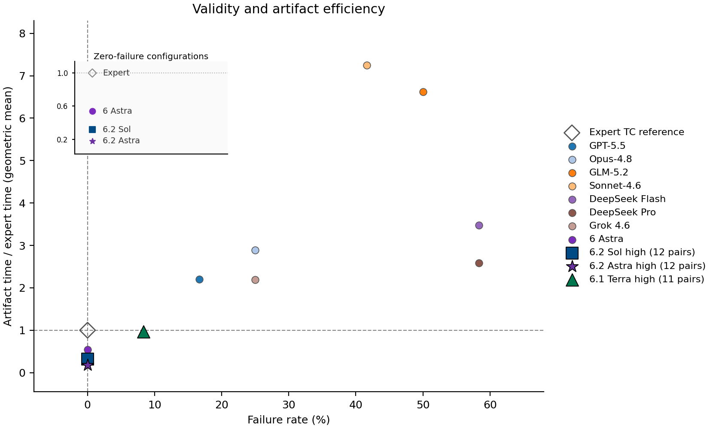

# GPT-6.1 Terra high benchmark results

**11/12 automatic passes** on TensorCircuit 1.8, audited by GPT-6 Astra high. Selected solver executions: **49.75 minutes**, **$1.0304** recorded. Geometric mean artifact/expert runtime: **0.969×** (11 measured pairs; lower is faster).

The reported cohort is the complete second round (11/12), not a best-of-two selection. Round 1 passed 10/12. In round 2 Task 01 passed, while Task 08 still had no submitted solution. The original round remains separate.

| Challenge | Functional | Static | Audit | Expert (s) | Artifact (s) | Artifact / expert |
|---|---:|---:|---:|---:|---:|---:|
| 01 | 1 | 1 | 1 | 62.39 | 736.26 | 11.80× |
| 02 | 1 | 1 | 1 | 5.44 | 10.18 | 1.87× |
| 03 | 1 | 1 | 1 | 4.86 | 11.17 | 2.30× |
| 04 | 1 | 1 | 1 | 13.02 | 12.34 | 0.95× |
| 05 | 1 | 1 | 1 | 119.91 | 123.71 | 1.03× |
| 06 | 1 | 1 | 1 | 61.07 | 22.27 | 0.36× |
| 07 | 1 | 1 | 1 | 123.58 | 192.85 | 1.56× |
| 08 | 0 | 0 | 0 | 50.00 (est.) | — | — |
| 09 | 1 | 1 | 1 | 45.47 | 7.93 | 0.17× |
| 10 | 1 | 1 | 1 | 17.62 | 4.43 | 0.25× |
| 11 | 1 | 1 | 1 | 155.92 | 160.60 | 1.03× |
| 12 | 1 | 1 | 1 | 7.85 | 4.37 | 0.56× |

Direct same-host measurement unavailable: 08 (expert exceeded the memory limit, no valid submission). [Replay evidence](../gpt61-terra-high-benchmark/timing-evidence.json).

Task 08 uses the [reviewer’s expert-reference replacement](https://github.com/sxzgroup/ORBIT-Q/pull/29#issuecomment-5549266776): 25.05 s × 2, rounded to **50 s**. Only the expert reference is estimated. The measured-only geometric mean is 0.969× (11 pairs).

[Methods](../gpt61-terra-high-benchmark/METHODS.md) · [Trial records](../gpt61-terra-high-benchmark/trials.json) · [Published runtimes](../gpt61-terra-high-benchmark/published-runtimes.json) · [Measured pairs](../gpt61-terra-high-benchmark/paired-runtimes.json)

