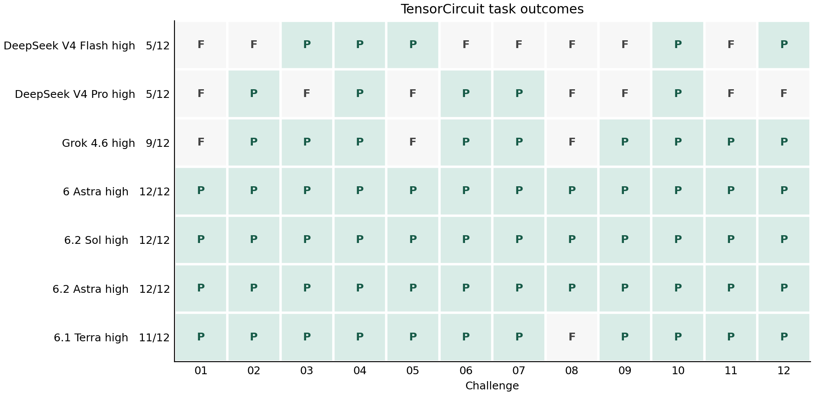
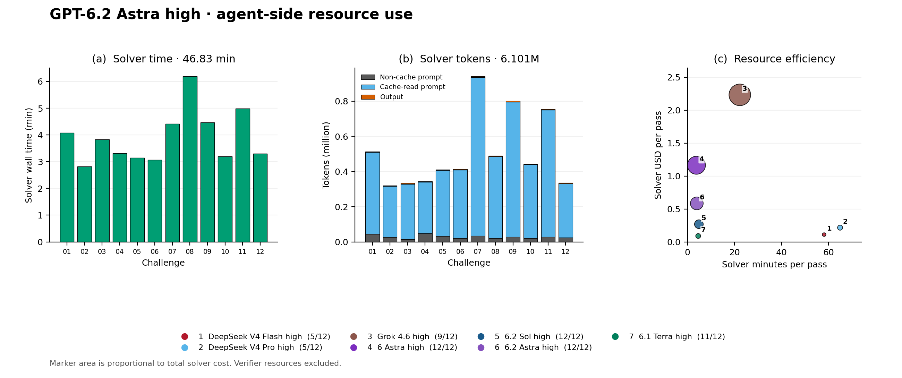
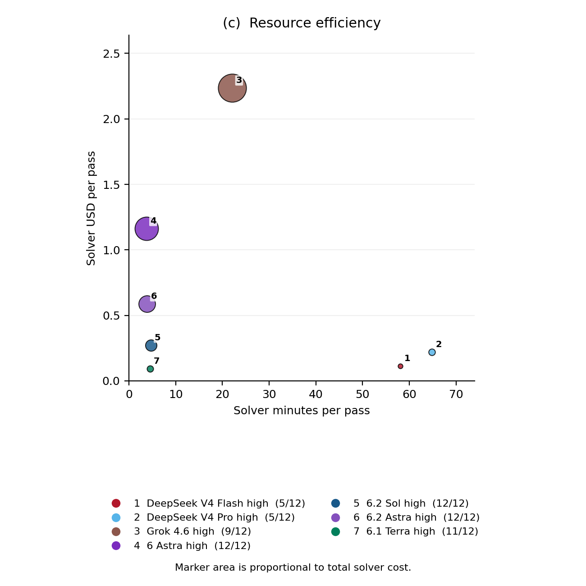
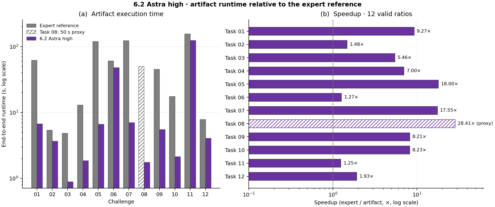
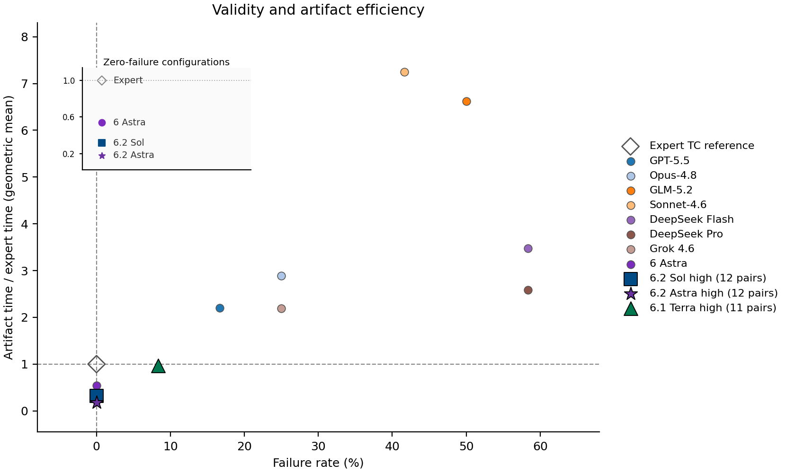

# GPT-6.2 Astra high benchmark results

**12/12 automatic passes** on TensorCircuit 1.8, audited by GPT-6 Astra high. Selected solver executions: **46.83 minutes**, **$7.0637** recorded. Geometric mean artifact/expert runtime: **0.178×** (11 measured pairs and one estimated expert reference; lower is faster).

Round 1 passed 12/12. Its Task 07 solver cost was not recorded. For the complete-cost comparison only, Task 07 is represented by its independent passing repeat; time, tokens, recorded cost, candidate and replay all come from that same repeat. The other 11 tasks are unchanged. This is a 12-task reporting cohort, not a continuous single round or the total spend across both attempts.

| Challenge | Functional | Static | Audit | Expert (s) | Artifact (s) | Artifact / expert |
|---|---:|---:|---:|---:|---:|---:|
| 01 | 1 | 1 | 1 | 62.39 | 6.73 | 0.11× |
| 02 | 1 | 1 | 1 | 5.44 | 3.67 | 0.67× |
| 03 | 1 | 1 | 1 | 4.86 | 0.89 | 0.18× |
| 04 | 1 | 1 | 1 | 13.02 | 1.86 | 0.14× |
| 05 | 1 | 1 | 1 | 119.91 | 6.66 | 0.06× |
| 06 | 1 | 1 | 1 | 61.07 | 48.10 | 0.79× |
| 07 | 1 | 1 | 1 | 123.58 | 7.04 | 0.06× |
| 08 | 1 | 1 | 1 | 50.00 (est.) | 1.76 | 0.04× |
| 09 | 1 | 1 | 1 | 45.47 | 5.54 | 0.12× |
| 10 | 1 | 1 | 1 | 17.62 | 2.14 | 0.12× |
| 11 | 1 | 1 | 1 | 155.92 | 124.94 | 0.80× |
| 12 | 1 | 1 | 1 | 7.85 | 4.07 | 0.52× |

Direct same-host measurement unavailable: 08 (expert exceeded the memory limit). [Replay evidence](timing-evidence.json).

Task 08 uses the [reviewer’s expert-reference replacement](https://github.com/sxzgroup/ORBIT-Q/pull/29#issuecomment-5549266776): 25.05 s × 2, rounded to **50 s**. Only the expert reference is estimated. The measured-only geometric mean is 0.207× (11 pairs).

[Methods](METHODS.md) · [Trial records](trials.json) · [Published runtimes](published-runtimes.json) · [Measured pairs](paired-runtimes.json)

