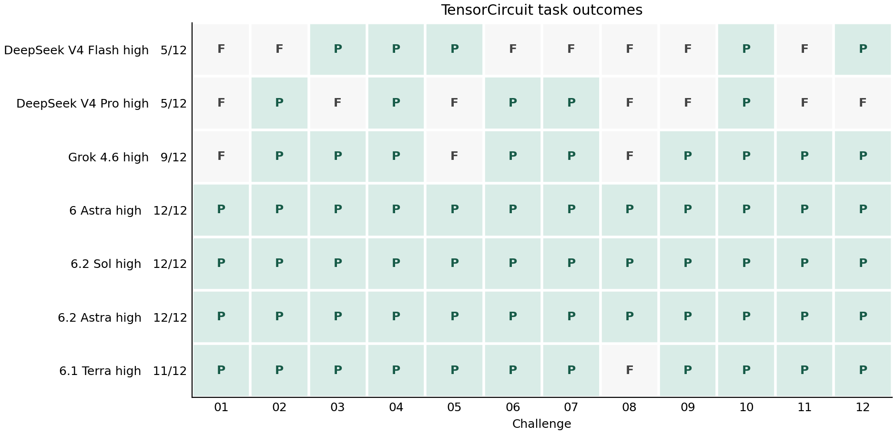
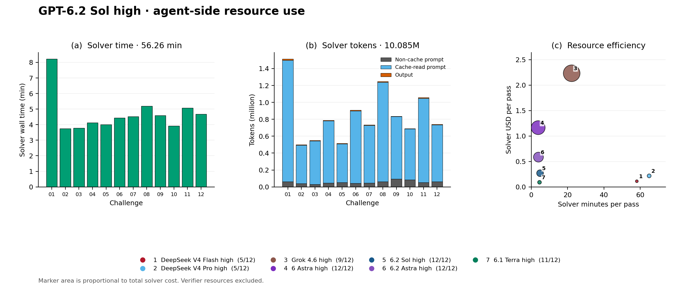
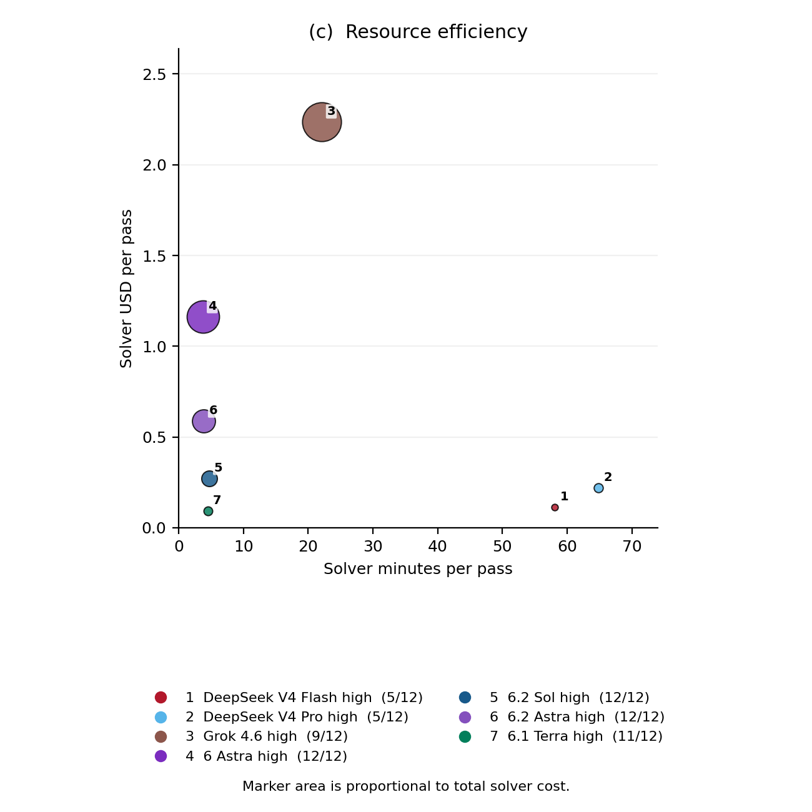
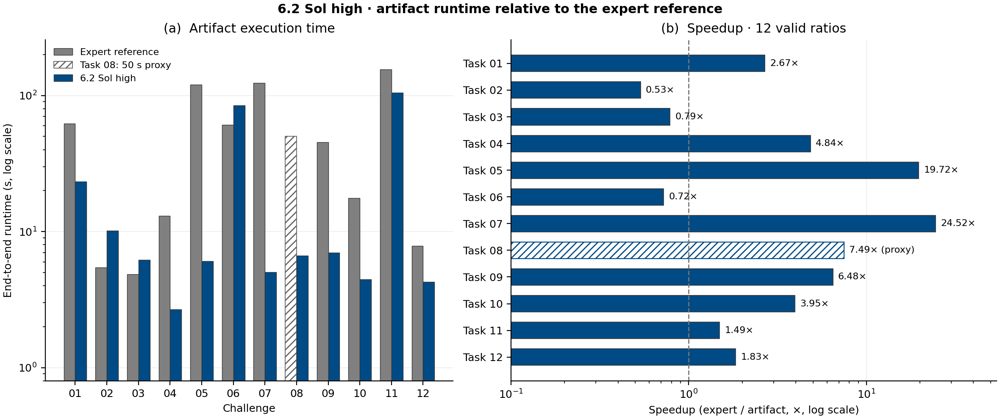
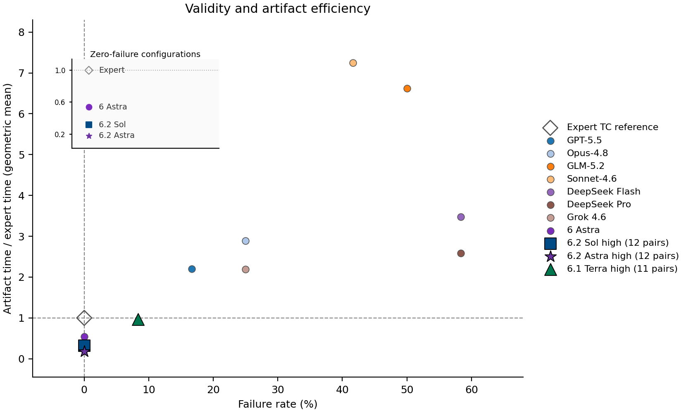

# GPT-6.2 Sol high benchmark results

**12/12 automatic passes** on TensorCircuit 1.8, audited by GPT-6 Astra high. Selected solver executions: **56.26 minutes**, **$3.2753** recorded. Geometric mean artifact/expert runtime: **0.316×** (11 measured pairs and one estimated expert reference; lower is faster).

The reported cohort is the original 12-task round.

| Challenge | Functional | Static | Audit | Expert (s) | Artifact (s) | Artifact / expert |
|---|---:|---:|---:|---:|---:|---:|
| 01 | 1 | 1 | 1 | 62.39 | 23.33 | 0.37× |
| 02 | 1 | 1 | 1 | 5.44 | 10.17 | 1.87× |
| 03 | 1 | 1 | 1 | 4.86 | 6.19 | 1.27× |
| 04 | 1 | 1 | 1 | 13.02 | 2.69 | 0.21× |
| 05 | 1 | 1 | 1 | 119.91 | 6.08 | 0.05× |
| 06 | 1 | 1 | 1 | 61.07 | 84.46 | 1.38× |
| 07 | 1 | 1 | 1 | 123.58 | 5.04 | 0.04× |
| 08 | 1 | 1 | 1 | 50.00 (est.) | 6.68 | 0.13× |
| 09 | 1 | 1 | 1 | 45.47 | 7.02 | 0.15× |
| 10 | 1 | 1 | 1 | 17.62 | 4.46 | 0.25× |
| 11 | 1 | 1 | 1 | 155.92 | 104.51 | 0.67× |
| 12 | 1 | 1 | 1 | 7.85 | 4.28 | 0.55× |

Direct same-host measurement unavailable: 08 (expert exceeded the memory limit). [Replay evidence](timing-evidence.json).

Task 08 uses the [reviewer’s expert-reference replacement](https://github.com/sxzgroup/ORBIT-Q/pull/29#issuecomment-5549266776): 25.05 s × 2, rounded to **50 s**. Only the expert reference is estimated. The measured-only geometric mean is 0.342× (11 pairs).

[Methods](METHODS.md) · [Trial records](trials.json) · [Published runtimes](published-runtimes.json) · [Measured pairs](paired-runtimes.json)

