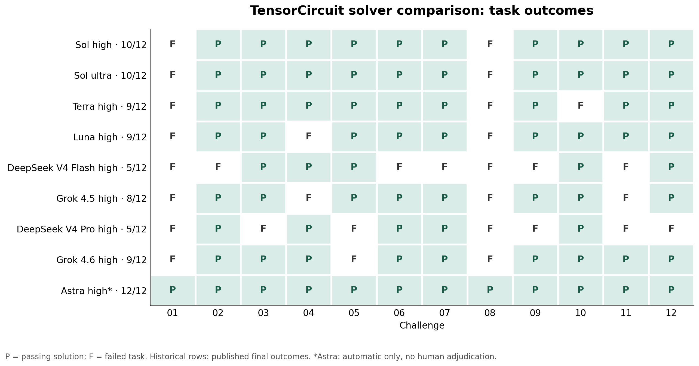
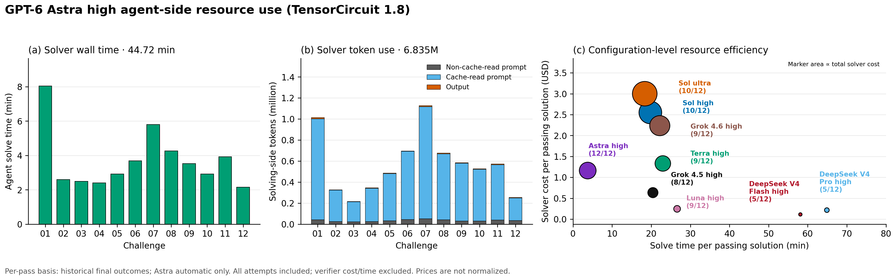

# GPT-6 Astra high — TensorCircuit benchmark

**12/12 automatic passes**, including functional checks, static policy and the
independent **GPT-5.6 Sol high** audit. Run: 2026-09-05; one fresh container/session
per task, no retries, candidate edits or historical solutions supplied.

## Results

| Solver | Automatic passes | Adjudicated passes | Solve time (min) | Tokens (M) | Recorded USD |
|---|---:|---:|---:|---:|---:|
| Sol high | 9/12 | 10/12 | 197.70 | 26.071 | 25.53 |
| Sol ultra | 10/12 | 10/12 | 182.80 | 33.048 | 30.02 |
| **Astra high** | **12/12** | Not adjudicated | **44.72** | **6.835** | **13.97** |

Sol's final failures are **01 and 08** in both runs. Historical corrections:
high 05 → pass; ultra 07 → pass and 08 → fail. Astra's results are unmodified
automatic scores, not equivalent to a completed human review.

## Main findings

- **Coverage:** Astra 01 preserves the supplied MPS and uses exact light-cone
  contractions; 08 uses exact two-row conditional sampling. These avoid the
  approximations rejected in the Sol submissions and pass the automatic audit.
- **Efficiency:** versus Sol high, Astra uses **73.8% fewer tokens**, **77.4% less
  solver time** and **45.3% less recorded cost**. Its artifact-runtime geometric
  mean ratio is **0.427×** on ten common-passing tasks. Not every task is faster:
  challenge 06 takes 108.47 s versus Sol high's 23.39 s.
- **Effort:** Sol ultra and high finish with the **same ten valid tasks**. Ultra
  uses **26.8% more tokens**, **17.6% more cost**, and **7.5% less solver time**;
  common-valid artifact runtime averages **0.815×** geometrically. Astra high
  changes the model, so it does **not** isolate Astra's effort effect.





Both figures have **PNG, PDF and SVG** versions in [figs/](figs/).
Verify the archive offline with Python 3.10+ (standard library only):

```bash
python3 results/gpt6astra-high/verify_archive.py
```

Rebuild figures with NumPy and Matplotlib, without rerunning any solver:

```bash
python3 results/gpt6astra-high/make_figures.py
```

## Scope and reproducibility

Fresh branch from `0201238`; unchanged task/prompt content and quantum image
dependencies; 6 CPUs and 10 GiB per container. Astra requires solver CLI 0.153.3;
the verifier retains CLI 0.145.0. One trial per configuration, different dates
and backend conditions, and the CLI change limit causal comparisons. Tokens
include cache reads; recorded solver costs exclude verification and are not
price-normalized billing totals.

[Measurements](comparison.json) · [Cross-model data](public-model-comparison.json) ·
[Methods and provenance](METHODS.md) ·
[Protocol](protocol.json) · [Isolation checks](contamination-audit.json) ·
[Submission provenance](submission.json)
