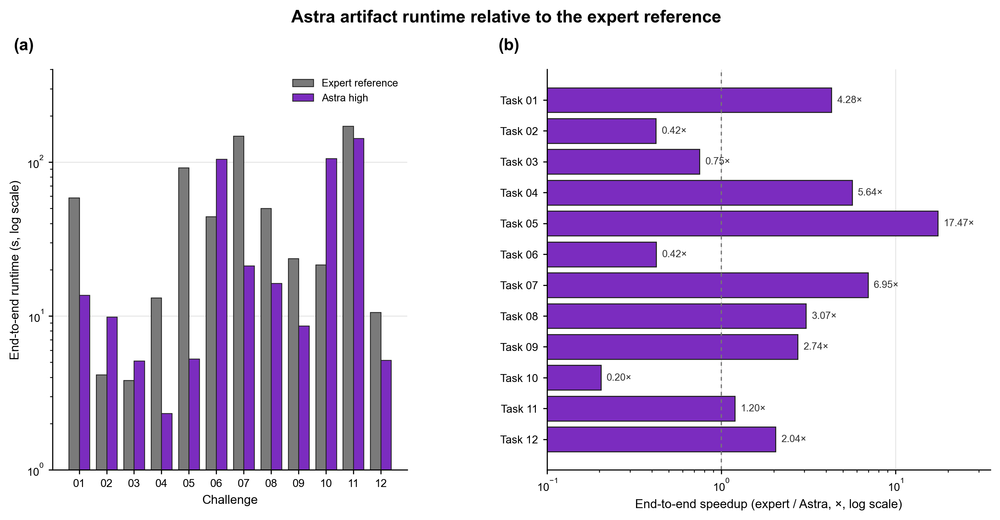
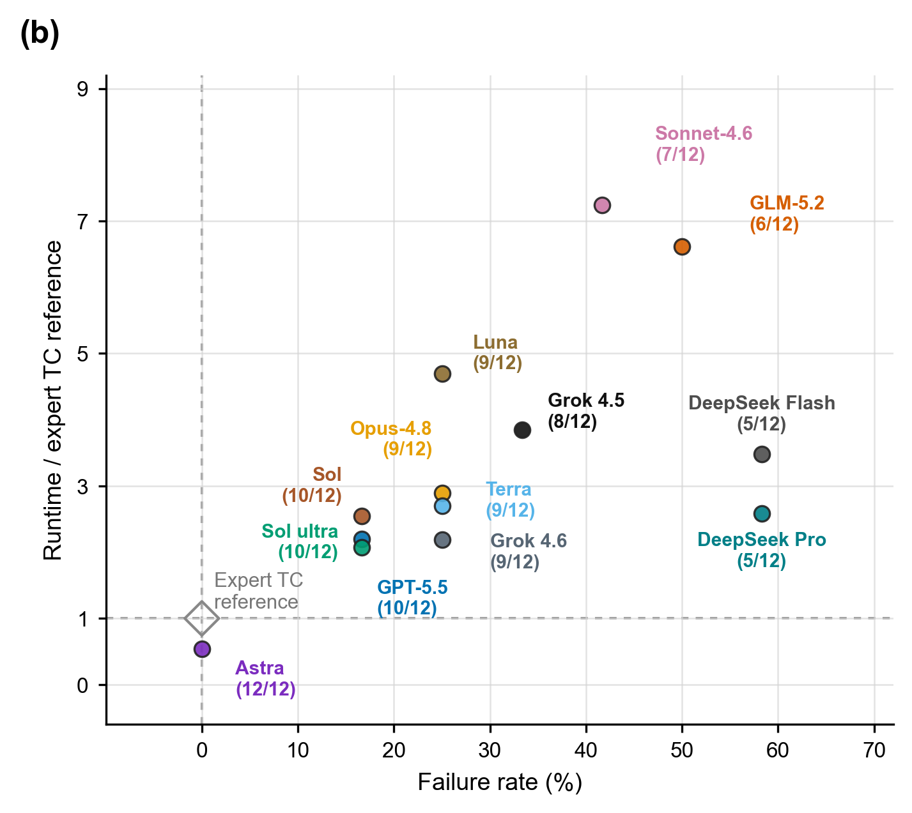

# Astra artifact runtime update

Following the [reviewer's suggestion](https://github.com/sxzgroup/ORBIT-Q/pull/29#issuecomment-5549266776), Task 08 uses an estimated expert reference of **50 s** (25.05 s × 2, rounded). Its Astra runtime remains the measured **16.31 s**. The other eleven pairs are unchanged same-host measurements. Original measurement records are preserved separately.

Across all 12 tasks, the geometric mean Astra/expert runtime ratio is **0.540×**, equivalent to **1.85×** geometric-mean speedup. Astra is faster on **8/12** tasks. Summed times are **440.81 s / 640.11 s = 0.689×**. This comparison contains 11 measured pairs and one estimated expert reference.

| Task | Expert reference (s) | Astra (s) | Astra / expert |
|---|---:|---:|---:|
| 01 | 58.59 | 13.68 | 0.233× |
| 02 | 4.15 | 9.84 | 2.371× |
| 03 | 3.82 | 5.10 | 1.335× |
| 04 | 13.13 | 2.33 | 0.177× |
| 05 | 91.87 | 5.26 | 0.057× |
| 06 | 44.26 | 104.66 | 2.365× |
| 07 | 147.46 | 21.22 | 0.144× |
| 08 | 50.00 | 16.31 | 0.326× |
| 09 | 23.64 | 8.63 | 0.365× |
| 10 | 21.51 | 105.57 | 4.908× |
| 11 | 171.11 | 143.04 | 0.836× |
| 12 | 10.57 | 5.17 | 0.489× |



Panel (b) shows expert/Astra speedup, the reciprocal of the table's runtime ratio.



Only Astra's artifact-runtime coordinate changes; all other model points and solver-cost figures are unchanged.

## Data and reproduction

[Measured pairs](astra_expert_paired.csv) · [Updated plot data](astra_expert_runtime.csv) · [Replacement provenance](astra_expert_adjustment.json).

The runtime figures and source data are also included in [PR #25](https://github.com/sxzgroup/ORBIT-Q/pull/25), pinned at [a3dd63a](https://github.com/QingyunQian/ORBIT-Q/tree/a3dd63a6d0eab02ae79abcc7a1723ffeda9b2611/paper). Its `paper/make_updated_paper_figures.py` rebuilds both figures from the same CSV data. The original solver artifacts, rewards and agent-resource figures are unchanged.

Verify this runtime supplement without Docker or API access:

```bash
python3 results/gpt6astra-high/runtime/verify_runtime.py
```
