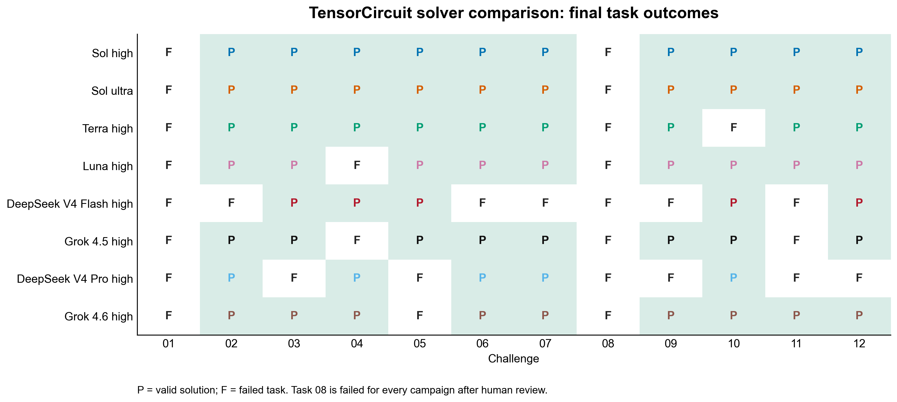
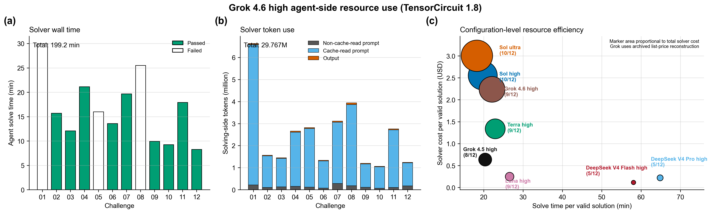

# Grok 4.6 (high) on ORBIT-Q

Grok 4.6 solved **9/12** challenges under TensorCircuit `1.8.0.dev20260726`. The valid solutions are Tasks **02, 03, 04, 06, 07, 09, 10, 11, and 12**. GPT-5.6 Sol (high) independently audited every candidate.

## Results

| Task | Outcome | Candidate runtime | Reason when failed |
|---:|:---:|---:|---|
| 01 | F | — | Agent reached the 1800 s limit. |
| 02 | P | 12.36 s | — |
| 03 | P | 5.91 s | — |
| 04 | P | 17.61 s | — |
| 05 | F | 72.20 s | Functional checks passed, but the audit rejected problem fidelity and implementation correctness. |
| 06 | P | 24.95 s | — |
| 07 | P | 36.03 s | — |
| 08 | F | 47.47 s | Functional checks passed, but the audit rejected problem fidelity; also negative under the campaign-wide human Task 08 adjudication. |
| 09 | P | 58.45 s | — |
| 10 | P | 65.01 s | — |
| 11 | P | 180.41 s | — |
| 12 | P | 14.92 s | — |

The campaign produced 11 functional passes and 9 final audit-approved passes.

## Agent-side resources

- Agent wall time: **199.17 min** total.
- Solving-side tokens: **29.767M** total: 29.277M prompt tokens and 0.490M output tokens.
- Reconstructed solver cost: **$20.129532** total, or **$2.236615 per valid solution**, using the archived xAI list prices ($2/M uncached input, $0.50/M cached input, $6/M output).

## Protocol and provenance

- Solver: `grok-4.6`, reasoning effort `high`.
- Auditor: `gpt-5.6-sol`, reasoning effort `high`.
- TensorCircuit: exactly `1.8.0.dev20260726`.
- Immutable Docker image ID: `sha256:b059c5fa7f75702f9afbf94ec7866e102ac32afd59d25634ec0aca0fd56e2833`.
- Compatibility layer: reasoning-status restoration and schema-scoped integral tool-argument normalization; no recurrence of the prior integer-routing or reasoning-replay errors.
- Resources per task: 6 CPU, 10,240 MiB memory, 16,384 MiB storage.
- Execution: sequential; one valid non-infrastructure outcome per task; all selected attempts are `r1`.
- Frozen benchmark base: `0201238ec2983907e2891f5319f5fff2d00844d5`.
- Aggregate task-copy SHA-256: `19fe27b83eaf668b3df32d1a68902b08cbe28585f189290769018eb16d927895`.

Each `challenge-XX/` folder contains the available solution, verifier records, logs, configuration, and provenance stamp. Machine-readable aggregates are in [`summary.json`](summary.json).
